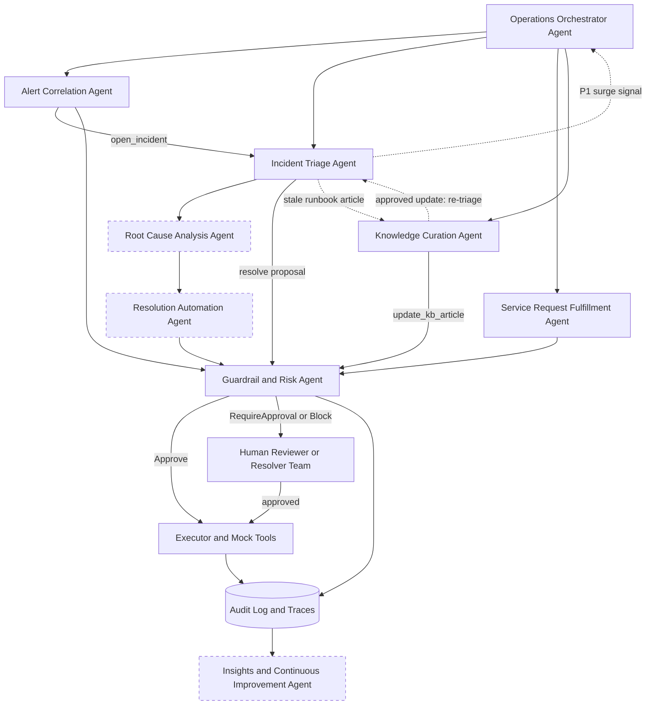

# NexaCore Systems: AI Agents for the To-Be Process

## Overview

The NexaCore Systems To-Be process uses specialized AI agents across Alert Observability, Incident Management, Service Request Fulfillment, Knowledge Management, remediation, governance, orchestration, and continuous improvement.

The recommended design contains **seven core AI agents** and **two supporting AI agents**.

### Implementation Status (prototype)

The prototype in `backend/` is an event-driven LangGraph graph. Six of the nine agents are separate nodes; the other three are covered partly by existing agents and tools. Every agent emits `ActionProposal`s; nothing executes until the Guardrail returns a verdict.

| Agent | Status | Code | Config |
|---|---|---|---|
| Alert Correlation | Implemented | `app/agents/alert_correlation.py` | `apps.yaml`, `settings.yaml` (`alert`) |
| Incident Triage | Implemented | `app/agents/incident_triage.py` | `taxonomy.yaml`, `skills.yaml`, `settings.yaml` (`triage`, `sla_hours`) |
| Root Cause Analysis | Partial, inside Incident Triage | `incident_triage.decide` (similar incidents, runbook match, KB attach) | `settings.yaml` (`triage.similar_k`) |
| Service Request Fulfillment | Implemented (password reset, access provisioning) | `app/agents/sr_fulfilment.py`, `app/tools/mock_iam.py` | `entitlements.yaml` |
| Knowledge Curation | Implemented | `app/agents/kb_curation.py`, `app/tools/kb_store.py` | `settings.yaml` (`kb`) |
| Resolution Automation | Folded into Triage + Executor | `app/tools/runbooks.py`, `app/tools/executor.py` | `guardrail_policy.yaml` |
| Guardrail and Risk | Implemented, deterministic (no LLM) | `app/agents/guardrail.py` | `guardrail_policy.yaml` |
| Operations Orchestrator | Implemented as graph nodes | `app/graph/nodes.py` (`route_event`, `human_queue`, `p1_surge`), `app/runtime/` | `settings.yaml` (`sim`, `audit`) |
| Insights and Continuous Improvement | Partial (KPI simulation, evals) | `app/kpi/simulate.py`, `app/kpi/baseline.py` | `app/kpi/baseline.py` (`ASSUMPTIONS`) |

**LLM modes:** `rules` (default) runs every agent on a deterministic path. In `live` mode, Claude is called only for ambiguous cases (noise scores in the ambiguous band, triage, free-text SR intent, KB articles near the threshold). The Guardrail never uses an LLM.

---

## Core AI Agents

### 1. Alert Correlation Agent

**Purpose:** Eliminate alert noise and identify genuine operational incidents.

#### Responsibilities

- Deduplicate repeated alerts.
- Suppress known false positives and redundant events.
- Cluster related alerts into a single operational case.
- Correlate events across applications and infrastructure.
- Recommend whether an incident should be created.
- Recommend an appropriate alert severity.

#### Inputs

- Monitoring alerts
- Historical alert patterns
- Application and service topology
- Known suppression rules

#### Outputs

- Correlated alert or incident candidate
- Suppressed or grouped alerts
- Recommended severity
- Correlation explanation and confidence score

#### Business Problems Addressed

- High alert noise ratio
- Delayed alert acknowledgement
- Manual review of duplicate alerts

#### Implementation

- **Event:** `alert.received`.
- **Noise score:** `p_noise` is a logistic score built from each system's historical noise ratio and the alert name's false-positive rate.
- **Clustering:** alerts are deduplicated within `alert.dedupe_window_s` (600 s) and correlated across apps through `apps.yaml` `depends_on`. A suppressed cluster is re-scored whenever a new alert joins it.
- **Actions:** `acknowledge`, `open_incident` (with a provisional priority from `taxonomy.yaml` `severity_priority` + `tier_bump`), and `suppress` when p(noise) ≥ `suppress_confidence` (0.85).
- **Never suppressed:** Critical alerts (also enforced by the Guardrail `never_suppress_severities`).
- **Live mode:** only clusters with p(noise) between `ambiguous_low` (0.35) and 0.85 go to the LLM.

---

### 2. Incident Triage Agent

**Purpose:** Automate incident classification, prioritization, and routing.

#### Responsibilities

- Categorize incidents.
- Recommend priority based on impact and urgency.
- Assess affected services and users.
- Recommend the appropriate resolver group.
- Apply skills-based routing instead of round-robin assignment.
- Match new incidents with similar historical incidents.
- Suggest relevant knowledge articles or runbooks.

#### Inputs

- Incident ticket details
- Correlated alert data
- Historical incidents and resolutions
- Knowledge articles and runbooks
- Resolver-team skills and workload information

#### Outputs

- Categorized and prioritized incident
- Recommended resolver team
- Suggested knowledge article or runbook
- Triage explanation and confidence score

#### Business Problems Addressed

- Manual triage
- Incorrect assignments
- Slow escalation
- Long incident handling time

#### Implementation

- **Events:** `incident.created`, `incident.priority_changed`, `incident.sla_check`, `triage.hold_reassignments`, `triage.release_reassignments`.
- **Classification:** keyword rules from `taxonomy.yaml` (categories and `priority_keywords`). The priority is raised by app tier.
- **Routing:** skills-based routing from `skills.yaml`. Each team scores 3×category + 2×app + 1×priority fit, and ties go to the team with the lowest open workload.
- **Similar incidents and KB:** finds the top `similar_k` (3) past incidents by TF-IDF similarity. Only KB articles at or above `kb_attach_min_accuracy` (90%) are attached; the rest are listed as excluded.
- **SLA watch:** escalates once `escalate_at_fraction` (50%) of the `sla_hours` window has elapsed (P1 1h, P2 8h, P3 24h, P4 72h). P1/P2 incidents are escalated immediately.
- **Actions:** `classify`, `route`, `attach_kb`, `escalate`, and `hold_reassignment` (P3/P4 during a P1 surge). When a runbook matches, it also proposes `resolve` (see Resolution Automation).
- **P1 handling:** a P1 classification signals the Orchestrator to start the P1 surge.
- **Quality:** decisions on incidents in the golden set (`backend/data/golden/triage_labels.csv`) are scored against the labels.

---

### 3. Root Cause Analysis Agent

**Purpose:** Accelerate diagnosis and isolate probable causes.

#### Responsibilities

- Correlate incident, alert, and operational history.
- Analyze recurring failure patterns.
- Generate an incident timeline.
- Identify probable root causes.
- Recommend diagnostic actions and remediation options.
- Clearly distinguish evidence from hypotheses.

#### Inputs

- Incident records
- Monitoring events and logs
- Application dependencies
- Historical resolutions
- Relevant knowledge articles and runbooks

#### Outputs

- Root-cause hypothesis
- Supporting evidence
- Recommended diagnostic or remediation steps
- Confidence score

#### Business Problems Addressed

- Long mean time to resolve
- Heavy dependency on subject matter experts
- Repeated investigation of known issues

#### Implementation

**Status: partial, inside the Incident Triage Agent. There is no separate node.**

- **Built:**
  - Matches similar historical incidents (TF-IDF).
  - Matches a runbook by system and signature (`runbooks.match`).
  - Attaches trusted KB articles.
  - Correlates alerts by dependency in the Alert Correlation Agent.
  - The triage rationale cites this evidence.
- **Gaps:** no incident timeline, no explicit root-cause hypothesis, no separation of evidence from hypotheses, and no log ingestion.

---

### 4. Service Request Fulfillment Agent

**Purpose:** Automate repetitive, policy-based service requests.

#### Responsibilities

- Interpret and classify incoming service requests.
- Validate requester information and required approvals.
- Coordinate password-reset workflows.
- Coordinate access-provisioning workflows.
- Coordinate role-change workflows.
- Coordinate software-installation requests.
- Coordinate new-user onboarding workflows.
- Route exceptions to the human fulfillment team.

#### Inputs

- User request
- Requester identity and entitlement information
- Approval status
- Fulfillment policies
- Target-system connectors or mock APIs

#### Outputs

- Fulfilled request
- Approval request
- Exception or human escalation
- Execution evidence and audit record

#### Business Problems Addressed

- Service-request backlog
- High manual effort
- Low self-service rate
- Repetitive fulfillment work

#### Implementation

- **Events:** `sr.submitted` and `sr.surge_mode_on`.
- **Intent:** form requests are parsed deterministically. Free text goes through rules, or the LLM in live mode.
- **Identity:** checked through `mock_iam`. Unknown or inactive employees are rejected.
- **Automated request types** (`entitlements.yaml` `standard_request_types`):
  - **Password Reset** → `reset_password`.
  - **Access Provisioning** → `grant_access`, when the requester's role is entitled to the system.
- **Always human:** privileged levels (`admin`, `owner`, `superuser`, `write-all`) and privileged systems (`BillingEngine`, `AuthService`). The Guardrail also blocks privileged access from being auto-approved.
- **Assist mode:** ticket-channel requests are pre-validated and then `route_to_human`, unless surge mode is on.
- **Surge drain (SR-7):** during a P1 surge, pending self-service-eligible requests are pulled back out of the human queue and fulfilled.
- **Gap:** role changes, software installs and onboarding are not automated. They are routed to a human with `route_to_human`.

---

### 5. Knowledge Curation Agent

**Purpose:** Maintain the quality, relevance, and usefulness of the knowledge base.

#### Responsibilities

- Score article accuracy and completeness.
- Detect outdated articles.
- Identify missing knowledge based on incident and escalation patterns.
- Detect duplicate or overlapping articles.
- Recommend whether an article should be retained, updated, merged, or archived.
- Draft update suggestions for human review.
- Track whether articles successfully support incident resolution.

#### Inputs

- Knowledge articles
- Incident outcomes
- Article usage information
- Escalation information
- Resolver feedback

#### Outputs

- Knowledge health score
- Update recommendation
- Archive or merge recommendation
- Knowledge-gap candidate
- Draft content changes for approval

#### Business Problems Addressed

- Outdated knowledge content
- Low knowledge accuracy
- High escalation despite knowledge availability
- Direct reliance on subject matter experts

#### Implementation

- **Events:** `kb.review` (one article or `ALL`) and `kb.validate_related` (sent during a P1 surge for the affected system).
- **Accuracy score:** 100 minus three penalties, all from `settings.yaml` `kb`:
  - Freshness: 0.1 per day past 180 days, capped at 35.
  - Escalation: weight 0.6, capped at 35.
  - Deprecated references: 8 each, capped at 24, using the `deprecated_paths` map.
- **Recommendation:**
  - `keep` at ≥ 90%.
  - `archive` below 70% with ≤ 60 uses, or when the article is a duplicate title.
  - `update` otherwise.
- **Live mode:** only articles within ±8 points of the threshold go to the LLM.
- **Drafts:** drafted updates become `update_kb_article` proposals, which **always** need human approval.
- **After approval:** open incidents whose runbook article was stale are re-triaged. Their old `resolve` approval is superseded, and the Guardrail decides again on the new facts.
- **Gap:** no detection of knowledge gaps (missing articles) and no capture of resolver feedback.

---

### 6. Resolution Automation Agent

**Purpose:** Execute approved remediation for known and repeatable scenarios.

#### Responsibilities

- Select an approved runbook for a recognized issue.
- Prepare the proposed remediation action.
- Request authorization from the Guardrail and Risk Agent.
- Execute approved runbooks or mock actions.
- Verify whether service health has recovered.
- Capture execution evidence.
- Update the incident with the action and outcome.
- Reopen or escalate when remediation fails.

#### Inputs

- Incident diagnosis
- Approved runbooks
- Guardrail decision
- Target-system interfaces

#### Outputs

- Remediation result
- Verification result
- Updated incident status
- Execution and audit logs

#### Business Problems Addressed

- Slow manual remediation
- Inconsistent execution of known fixes
- Repeated operational intervention

#### Implementation

**Status: folded into the Incident Triage Agent and the Executor. There is no separate node.**

- **Runbook library:** `app/tools/runbooks.py` holds 14 scripted runbooks. Each has systems, signatures, a `reversible` flag, a rollback and a linked KB article.
- **Proposal:** The Incident Triage Agent proposes `resolve` with the matched runbook. The Guardrail evaluates it.
- **Execution:** `executor._resolve` runs the steps, marks the incident Resolved, records the SLA outcome, and ends the P1 surge when the last P1 closes.
- **Stale runbook article:** The Incident Triage Agent asks the Knowledge Curation Agent for a refresh (`kb.review` with a draft). Auto-resolution unlocks after the update is approved.
- **Gaps:**
  - No check after execution that service health has recovered.
  - No automatic reopen or escalation when a fix fails.
  - Runbooks are mock and always succeed.

---

### 7. Guardrail and Risk Agent

**Purpose:** Govern autonomous decisions and prevent unsafe actions.

#### Responsibilities

- Evaluate operational risk.
- Validate agent confidence against defined thresholds.
- Check policy, approval, and change-control requirements.
- Restrict unsupported or high-impact actions.
- Enforce human approval where required.
- Record the decision, evidence, and approving party.
- Approve, hold for human approval, or block a proposed action.

#### Inputs

- Agent recommendation
- Proposed action
- Confidence score
- Risk classification
- Applicable policies and approval rules

#### Outputs

- `Approve`: execute automatically
- `RequireApproval`: queue for a human decision
- `Block`: never executed; a human can only reject it
- Failed and passed rules, reasons, and the policy version
- Governance and audit record

#### Business Problems Addressed

- Unsafe automation
- Uncontrolled production actions
- Lack of auditability
- Compliance and accountability concerns

#### Implementation

The Guardrail is deterministic in every LLM mode (ADR-0001). The policy lives in `guardrail_policy.yaml` (versioned). Checks run in this order:

1. **Kill switch** (global, per agent, or per app). When it is on, the verdict is `RequireApproval`.
2. **Always-human actions** (`update_kb_article`, `manual_review`) → `RequireApproval`.
3. **Pass-through actions** (`acknowledge`, `open_incident`, `classify`, `route`, `attach_kb`, `escalate`, `route_to_human`, `hold_reassignment`) → `Approve`. They are non-mutating and are logged.
4. **Gated actions** (`resolve`, `remediate`, `reset_password`, `grant_access`, `suppress`) must pass every rule in scope. Scope is set per action by `rule_scope`; for example, the priority, tier, freeze and KB rules apply only to `resolve`/`remediate`:
   - Confidence ≥ 0.85.
   - Priority is P3 or P4.
   - App is Tier 2 or 3.
   - The action is reversible.
   - It is outside the month-end billing freeze (days 28–5).
   - The linked KB article's accuracy is ≥ 90%.
   - Blast radius is < 50 users.
   - The 30-day reopen rate is ≤ 5%.
   - No privileged access.
   - The alert is not Critical (for `suppress`).
5. **Unknown actions** fail safe to a human.
6. **Any rule fails** → `RequireApproval`. An irreversible action on a Tier-0 app → `Block`.

Held items wait in the approvals queue (`app/runtime/approvals.py`; Guardrail Queue page). Every verdict is written to the audit log with the failed rules, passed rules and policy version.

---

## Supporting AI Agents

### 8. Operations Orchestrator Agent

**Purpose:** Coordinate the end-to-end workflow across all specialized agents.

#### Responsibilities

- Receive operational events and requests.
- Determine which specialized agent should act next.
- Maintain case context across agent interactions.
- Sequence tasks and manage dependencies.
- Handle retries, exceptions, and time-outs.
- Pause workflows that require human input.
- Prevent duplicate or conflicting agent actions.

#### Example Incident Sequence

1. The Alert Correlation Agent groups and filters related alerts.
2. The Incident Triage Agent classifies and routes the incident.
3. The Root Cause Analysis Agent proposes the probable cause and remediation.
4. The Guardrail and Risk Agent evaluates the proposed action.
5. The Resolution Automation Agent runs an approved remediation.
6. The Knowledge Curation Agent captures a reusable resolution or recommends a KB update.
7. The Insights and Continuous Improvement Agent updates operational trends.

#### Outputs

- Coordinated workflow state
- Shared case context
- Agent task assignments
- Exception and escalation routing
- End-to-end trace

#### Implementation

- **Event bus:** SQLite-backed (`app/runtime/bus.py`). Events:
  - `alert.received`
  - `incident.created`, `incident.priority_changed`, `incident.sla_check`
  - `sr.submitted`, `sr.surge_mode_on`, `sr.surge_mode_off`
  - `kb.review`, `kb.validate_related`
  - `triage.hold_reassignments`, `triage.release_reassignments`
- **Routing:** `route_event` maps each event type to an agent through `ROUTES` in `app/graph/nodes.py`. Graph: agent → `guardrail` → `execute` and/or `human_queue` → `finalize`.
- **Failure handling (OR-4):** any agent exception or LLM timeout becomes a `manual_review` proposal, so the case moves to a human instead of being lost. LLM calls retry up to `llm.max_attempts` (3).
- **No stacked approvals:** an identical pending approval (same action and entity) is never created twice.
- **P1 surge (OR-2):** when the Incident Triage Agent classifies a P1, the `p1_surge` node turns surge mode on and fans out in three directions:
  - Service Request Fulfillment Agent absorbs the request queue.
  - Knowledge Curation Agent validates related articles.
  - Incident Triage Agent holds P3/P4 reassignments.
- **Surge end:** `sr.surge_mode_off` (sent when the last P1 is resolved) releases held reassignments.
- **Tracing:** every node run is an audited span in an end-to-end trace (ADR-0004; Audit Trail page).
- **Gap:** no generic retry or time-out scheduler for long-running workflows.

---

### 9. Insights and Continuous Improvement Agent

**Purpose:** Monitor operational performance and identify improvement opportunities.

#### Responsibilities

- Track service-level and operational KPIs.
- Detect incident, alert, service-request, and knowledge trends.
- Identify recurring SLA-breach patterns.
- Identify additional automation candidates.
- Recommend alert-rule tuning.
- Recommend routing and staffing improvements.
- Generate operational and executive insights.

#### Inputs

- Incident outcomes
- Alert outcomes
- Service-request outcomes
- Knowledge quality and usage information
- Agent decisions and audit logs

#### Outputs

- MTTR and SLA trends
- Alert-noise insights
- Automation opportunities
- Knowledge-improvement candidates
- Operational improvement recommendations

#### Business Problems Addressed

- Manual reporting
- Lack of real-time visibility
- No closed feedback loop
- Limited continuous improvement

#### Implementation

**Status: partial. KPI simulation only; no agent node.**

- **Simulation:** `app/kpi/simulate.py` replays scenarios in an isolated database and reports 10 KPIs against the case-study baselines (`app/kpi/baseline.py`): alert noise, acknowledgement time, triage time, self-service, SR breach, KB accuracy, KB escalation, MTTR, SLA compliance and cost.
- **Labelling:** each "after" value is labelled **measured** (from the replay) or **modelled** (from the stated `ASSUMPTIONS`).
- **Accuracy:** batch accuracy is computed on the golden triage set and the seed alerts.
- **Gaps:** no trend detection, no SLA-breach pattern mining, and no automated recommendations for alert tuning, routing or staffing.

---

## Recommended Agent Interaction Model

Dashed boxes are agents that are partial or folded into other agents in the prototype (see Implementation Status).

---

## Human-in-the-Loop Decision Model

### Low Risk and High Confidence

- The proposed action follows an approved policy or runbook.
- The action has limited operational impact.
- The Guardrail and Risk Agent authorizes automated execution.

**Result:** Automatic fulfillment or remediation.

### Medium Risk or Moderate Confidence

- The agent prepares a recommendation and supporting evidence.
- A human reviewer approves, rejects, or modifies the action.

**Result:** Human-approved execution.

### High Risk, P1, or Production Change

- Automated execution is blocked by default.
- The incident is escalated to the appropriate resolver or change authority.
- The system may continue collecting evidence and recommending actions, but the human remains the decision-maker.

**Result:** Mandatory human decision and controlled execution.

### How the Prototype Maps These Tiers

| Tier | Guardrail verdict | Policy triggers (`guardrail_policy.yaml`) |
|---|---|---|
| Low risk, high confidence | `Approve` | Pass-through action, or a gated action that passes every rule: confidence ≥ 0.85, P3/P4, Tier 2–3, reversible, outside the freeze window, KB ≥ 90%, blast radius < 50, reopen rate ≤ 5%, not privileged |
| Medium risk or moderate confidence | `RequireApproval` | Any rule fails; `update_kb_article` or `manual_review`; kill switch on |
| High risk, P1, or production change | `RequireApproval` / `Block` | `resolve`/`remediate` on P1/P2 or Tier 0–1 always needs a human; an irreversible action on Tier 0 is `Block` (reject only) |

---

## Configuration

The agents' behavior depends on assumptions in `backend/config/`. Change these before changing agent code.

| File | Purpose | Used by |
|---|---|---|
| `apps.yaml` | App catalogue: tier, owner team, users affected (blast radius), `depends_on` topology | Alert Correlation, Incident Triage, Guardrail |
| `taxonomy.yaml` | Incident categories, keywords, priority keywords, severity→priority mapping, tier bump | Incident Triage, Alert Correlation |
| `skills.yaml` | Resolver-team skills matrix and capacity for skills-based routing | Incident Triage |
| `entitlements.yaml` | Role→system self-service entitlements, privileged levels and systems, standard request types | SR Fulfillment, Guardrail |
| `guardrail_policy.yaml` | Pass-through and always-human actions, approve-only-if rules, rule scope, block rules, freeze windows | Guardrail |
| `settings.yaml` | Sim clock and timezone, alert thresholds, SLA hours, triage and KB scoring, LLM retries, audit settings | All agents, Orchestrator |

Operator-changeable settings (kill switch, LLM mode, surge mode) are stored in the database `settings` table and are set from the Controls page.

---

## Suggested Agent Grouping for the Architecture Block Diagram

### Coordination Layer

- Operations Orchestrator Agent

### Operational Domain Agents

- Alert Correlation Agent
- Incident Triage Agent
- Root Cause Analysis Agent
- Service Request Fulfillment Agent
- Knowledge Curation Agent

### Action and Governance Layer

- Resolution Automation Agent
- Guardrail and Risk Agent
- Human Reviewer or Resolver Team

### Improvement Layer

- Insights and Continuous Improvement Agent

---

## Summary

The recommended To-Be design uses **nine AI agents**:

1. Alert Correlation Agent (implemented)
2. Incident Triage Agent (implemented)
3. Root Cause Analysis Agent (partial, inside Incident Triage)
4. Service Request Fulfillment Agent (implemented for password reset and access provisioning)
5. Knowledge Curation Agent (implemented)
6. Resolution Automation Agent (folded into Triage + Executor)
7. Guardrail and Risk Agent (implemented, deterministic)
8. Operations Orchestrator Agent (implemented as LangGraph routing, human queue, and P1 surge nodes)
9. Insights and Continuous Improvement Agent (partial: KPI simulation and evals)

Together, these agents transform NexaCore's operating model from disconnected and manually intensive support processes into a coordinated, governed, and progressively automated Agentic Operations process. Human intervention remains mandatory for high-risk, low-confidence, or policy-restricted actions.

---

## Business Problem-to-Agent Mapping

The table below maps each AI agent to its primary operational domain, the business problems it addresses, and the expected business outcome.

| AI Agent | Primary Domain | Business Problems Addressed | Expected Outcome |
|---|---|---|---|
| **Alert Correlation Agent** | Alert Observability | High alert noise ratio; delayed alert acknowledgement; manual review of duplicate alerts | Reduced alert noise; faster detection of genuine incidents; improved alert-to-incident conversion |
| **Incident Triage Agent** | Incident Management | Manual triage; incorrect assignments; slow escalation; long incident handling time | Automated classification; skills-based routing; fewer assignment errors; faster incident handling |
| **Root Cause Analysis Agent** | Incident Management | Long mean time to resolve; heavy dependency on subject matter experts; repeated investigation of known issues | Faster diagnosis; reduced troubleshooting effort; accelerated resolution |
| **Service Request Fulfillment Agent** | Service Request Management | Service-request backlog; high manual effort; low self-service rate; repetitive fulfillment work | Automated fulfillment; reduced backlog; increased self-service adoption; lower manual workload |
| **Knowledge Curation Agent** | Knowledge Management | Outdated knowledge content; low knowledge accuracy; high escalation despite knowledge availability; direct reliance on subject matter experts | Improved knowledge quality; reduced escalations; higher first-contact resolution; better reuse of verified resolutions |
| **Resolution Automation Agent** | Operations Execution | Slow manual remediation; inconsistent execution of known fixes; repeated operational intervention | Faster recovery; consistent runbook execution; reduced operational workload |
| **Guardrail and Risk Agent** | Governance and Compliance | Unsafe automation; uncontrolled production actions; lack of auditability; compliance and accountability concerns | Controlled automation; policy enforcement; risk reduction; traceable decisions and approvals |
| **Operations Orchestrator Agent** | Workflow Coordination | Siloed operations; disconnected processes; context loss between teams and agents; inefficient handoffs; workflow delays | End-to-end coordination; shared context; streamlined handoffs; consistent workflow state and traceability |
| **Insights and Continuous Improvement Agent** | Reporting and Optimization | Manual reporting; lack of real-time visibility; no closed feedback loop; limited continuous improvement | KPI visibility; trend detection; operational improvement recommendations; identification of new automation opportunities |

---

## Failure Dimension-to-Agent Mapping

This table maps the major NexaCore failure dimensions to the agents that primarily address them.

| Failure Dimension | Primary AI Agents | How the Agents Address the Failure |
|---|---|---|
| **Alert Noise and Poor Observability** | Alert Correlation Agent; Root Cause Analysis Agent; Insights and Continuous Improvement Agent | Correlate related alerts, suppress duplicates and noise, analyze operational patterns, and recommend alert-rule improvements. |
| **Slow Incident Response and High MTTR** | Incident Triage Agent; Root Cause Analysis Agent; Resolution Automation Agent; Operations Orchestrator Agent | Automate triage and routing, accelerate diagnosis, execute approved runbooks, and coordinate the workflow from alert through verified recovery. |
| **Service Request Backlog and Manual Fulfillment** | Service Request Fulfillment Agent; Guardrail and Risk Agent; Operations Orchestrator Agent | Automate eligible requests, enforce policies and approval requirements, and route exceptions or human decisions without losing workflow context. |
| **Knowledge Quality and Escalation Issues** | Knowledge Curation Agent; Incident Triage Agent; Root Cause Analysis Agent | Identify outdated or missing knowledge, recommend relevant articles during triage, and turn verified incident findings into reusable knowledge candidates. |
| **Governance and Operational Risk** | Guardrail and Risk Agent; Operations Orchestrator Agent | Evaluate risk and policy requirements, enforce human approval, preserve workflow state, and record decisions and execution evidence. |
| **Cross-Domain Coordination and Context Sharing** | Operations Orchestrator Agent | Maintain shared case context, coordinate specialized agents and humans, manage dependencies, and preserve an end-to-end trace. |
| **Continuous Optimization and KPI Improvement** | Insights and Continuous Improvement Agent | Monitor outcomes and KPIs, detect recurring patterns, and recommend improvements to automation, routing, alerting, and knowledge. |

---

## Executive Problem-to-Agent Traceability

| Business Challenge | Primary AI Agent or Agent Combination | Intended Business Result |
|---|---|---|
| Too many duplicate or low-value alerts | Alert Correlation Agent | Lower alert noise and faster identification of actionable events |
| Slow incident classification and assignment | Incident Triage Agent | Faster triage and more accurate resolver routing |
| Slow diagnosis and repeated investigation | Root Cause Analysis Agent | Shorter investigation time and stronger evidence for remediation |
| Repetitive operational fixes | Resolution Automation Agent | Faster and more consistent recovery using approved runbooks |
| Service-request backlog | Service Request Fulfillment Agent | Higher automation and self-service with fewer manual fulfillment steps |
| Poor knowledge quality | Knowledge Curation Agent | More accurate, complete, and useful knowledge articles |
| Unsafe or noncompliant automation | Guardrail and Risk Agent | Risk-based control, required approvals, and complete auditability |
| Disconnected operational domains | Operations Orchestrator Agent | Coordinated end-to-end workflows with shared context and controlled handoffs |
| No continuous-improvement mechanism | Insights and Continuous Improvement Agent | Ongoing KPI tracking, trend analysis, and prioritized improvement recommendations |
